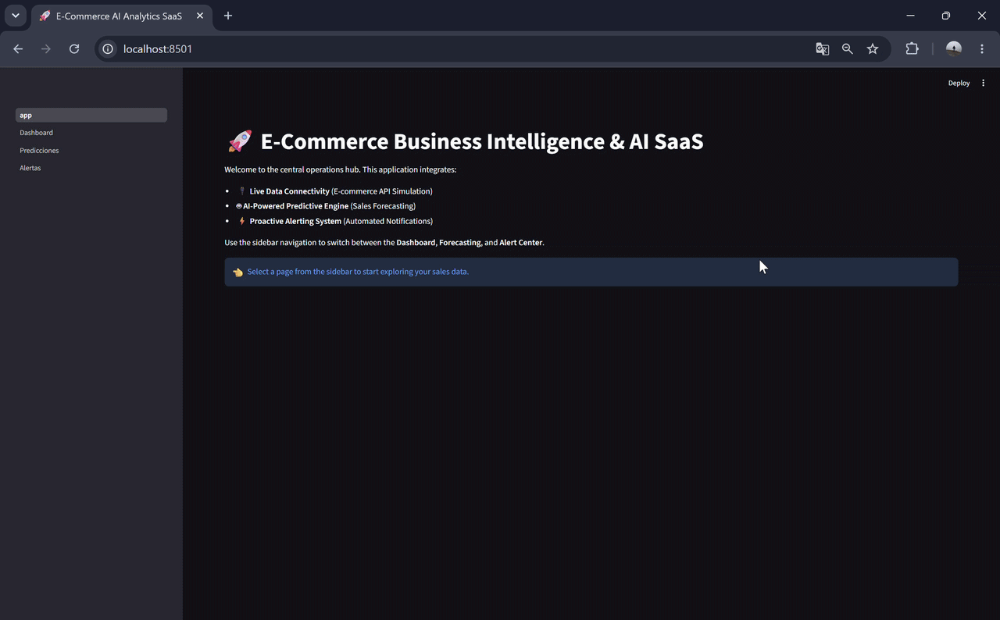

# 🚀 E-Commerce Business Intelligence & AI SaaS

An end-to-end commercial-grade micro-SaaS application built with Python and Streamlit. This project simulates live e-commerce API transactions, provides real-time sales performance metrics, leverages Meta's Prophet model for predictive revenue forecasting, and includes a proactive alert configuration hub.

[](https://crissnyx-ecommerce-pro-app-app.streamlit.app)



## 🌟 Key Features

- **🔌 Real-Time E-Commerce API Connector**: Simulates live transaction data from platforms like Shopify or Stripe.
- **📊 Dynamic Business Intelligence Dashboard**: Interactive KPIs and visual breakdown of daily revenue and sales distribution by category using Plotly.
- **🤖 AI-Powered Sales Forecasting**: Implements Meta Prophet machine learning models to project daily revenue trends with adjustable prediction horizons.
- **⚡ Proactive Alerting System**: Simulates automated alert setups via Webhooks (Slack/Discord) and WhatsApp (Twilio) for daily revenue thresholds.

## 🛠️ Tech Stack

- **Frontend / Framework**: Streamlit
- **Data Processing**: Pandas, NumPy
- **Data Visualization**: Plotly Express
- **Machine Learning Engine**: Meta Prophet
- **HTTP & API Integration**: Requests

## 🚀 Getting Started

### Prerequisites
- Python 3.9+ installed on your system.

### Installation

1. **Clone the repository:**
   ```bash
   git clone [https://github.com/crissnyx/ecommerce-pro-app.git](https://github.com/crissnyx/ecommerce-pro-app.git)
   cd ecommerce-pro-app